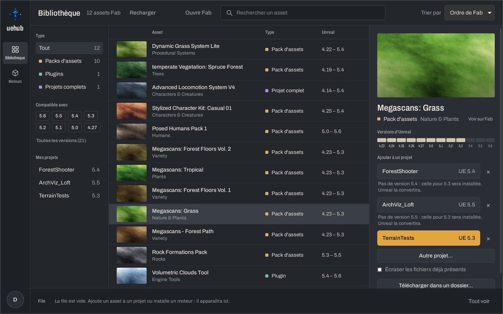
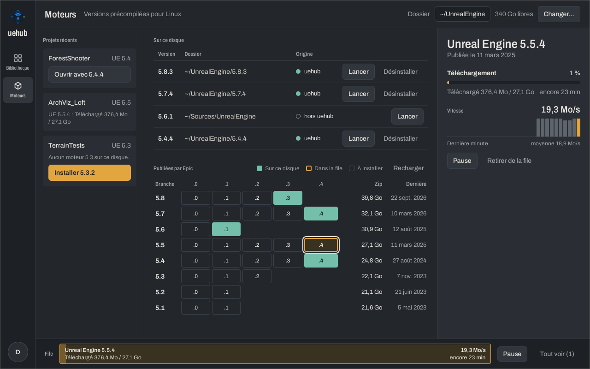
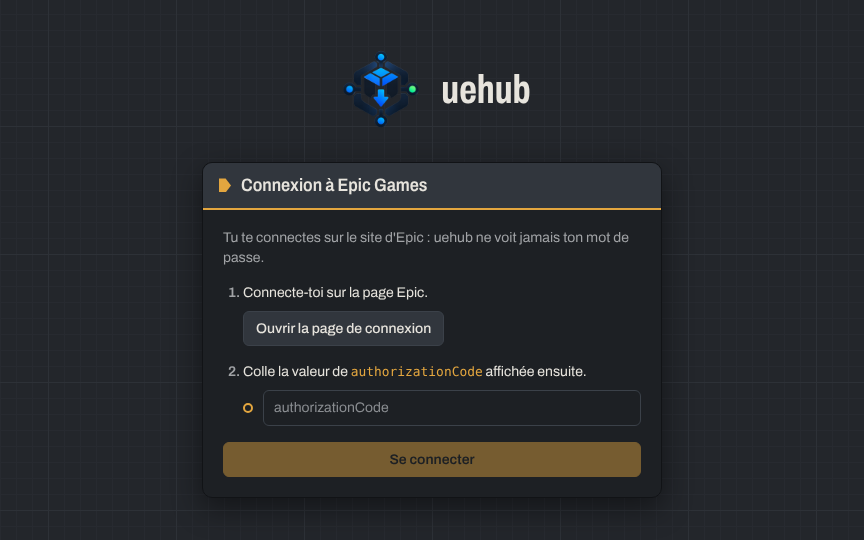

<p align="center">
  
</p>

<h1 align="center">uehub</h1>

<p align="center">
  <strong>Ta bibliothèque Fab et Unreal Engine, sous Linux.</strong><br>
  Ce dont un développeur Unreal a besoin dans l'Epic Games Launcher, sans Wine.
</p>

<p align="center">
  <a href="README.md">English</a> · Français
</p>

> [!NOTE]
> La première version arrive bientôt. En attendant, [compile uehub toi-même](#compiler-uehub).

<p align="center">
  
</p>

## Ce que fait uehub

- **Ta bibliothèque Fab, où chercher.** Tous les assets que tu possèdes sur Fab, avec
  leur type, les versions d'Unreal qu'ils couvrent, et des filtres par version du moteur
  ou par projet.
- **Directement dans tes projets.** Choisis un projet : uehub télécharge la version qui
  correspond à son moteur, range les plugins dans `Plugins/`, et n'écrase tes fichiers
  que si tu le demandes. Un projet complet se télécharge dans un dossier à lui.
- **Une file qui tient bon.** Les téléchargements passent un par un, résistent aux
  pauses, aux coupures de réseau et aux redémarrages, et gardent ce qu'ils ont déjà reçu.
- **Les mises à jour de ce que tu as ajouté.** uehub retient chaque asset qu'il a mis
  dans un projet, et te prévient quand le vendeur publie une nouvelle build, ou une
  version plus proche de ton moteur. Retirer un asset efface les fichiers qu'il a
  ajoutés, et seulement ceux-là.
- **Unreal Engine, installé pour toi.** Les versions précompilées pour Linux qu'Epic
  publie : tu en choisis une, tu vois la place qu'elle prendra, et uehub la télécharge,
  l'extrait et l'enregistre pour que tes projets s'ouvrent avec. Il te prévient quand un
  nouveau correctif de ta branche sort.
- **Fait pour rester ouvert.** Une notification quand un téléchargement finit pendant que
  tu es ailleurs, une recherche de mise à jour de uehub toutes les quelques heures, et un
  journal qu'on peut joindre sans risque à un rapport de bug.
- **En français et en anglais**, selon la langue de ton système, et un outil en ligne de
  commande pour les scripts et le terminal.

<table>
  <tr>
    <td width="50%"></td>
    <td width="50%"></td>
  </tr>
  <tr>
    <td align="center">L'installation d'Unreal Engine 5.5.4</td>
    <td align="center">La connexion, sur le site d'Epic</td>
  </tr>
</table>

## Installer uehub

uehub tourne sous Linux 64 bits (x86_64). Prends le paquet de ta distribution dans la
[dernière version publiée](https://github.com/AlexandreSama/uehub/releases/latest) :

| Distribution | Paquet | Mises à jour |
|---|---|---|
| Arch Linux, Manjaro, EndeavourOS | [`uehub` dans l'AUR](https://aur.archlinux.org/packages/uehub) : `yay -S uehub` | ton assistant AUR |
| Debian, Ubuntu, Linux Mint, Pop!_OS | `uehub_<version>_amd64.deb` | uehub lui-même |
| Fedora, openSUSE | `uehub-<version>-1.x86_64.rpm` | uehub lui-même |
| Toute autre distribution | `uehub_<version>_amd64.AppImage` | uehub lui-même |

Le `.deb`, le `.rpm` et l'AppImage se mettent à jour seuls : uehub cherche une nouvelle
version, montre ce qui change, et l'installe quand tu es d'accord. Chaque mise à jour est
signée, et uehub refuse celle dont la signature ne correspond pas.

**Ce qu'il faut à uehub**

- WebKitGTK 4.1, que proposent la plupart des distributions sorties depuis 2022 (les
  paquets l'installent).
- Un trousseau compatible Secret Service (GNOME Keyring, KWallet) pour garder ta session.
  Sans trousseau, uehub la range dans un fichier que toi seul peux lire.
- De la place pour les moteurs : Unreal Engine 5.8 prend environ 70 Go une fois extrait,
  plus son zip de 40 Go pendant l'installation. uehub vérifie avant de commencer.

## Premiers pas

1. **Connecte-toi.** uehub ouvre la page de connexion d'Epic dans ton navigateur. Une
   fois connecté, Epic affiche un court texte JSON : copie la valeur d'`authorizationCode`
   et colle-la dans uehub. Tu te connectes sur le site d'Epic : uehub ne voit jamais ton
   mot de passe. Ta session reste ensuite dans le trousseau de ton système.
2. **Ajoute un asset à un projet.** Choisis un asset dans la bibliothèque. Tes projets
   récents s'affichent avec ce qui se passera pour chacun : la version exacte, ou une
   plus ancienne qu'Unreal convertira. Clique sur un projet, ou choisis un autre
   `.uproject`.
3. **Installe un moteur.** Ouvre **Moteurs**. La première fois, Epic demande d'accepter
   le CLUF d'Unreal Engine sur son site : uehub t'ouvre la page. Choisis ensuite une
   version dans la grille et installe-la. Elle est enregistrée dans
   `~/.config/Epic/UnrealEngine/Install.ini`, comme un moteur que tu aurais compilé, et
   tes projets s'ouvrent avec elle depuis uehub.

## En ligne de commande

uehub a aussi un outil en ligne de commande, `uehub`, construit à partir de
`crates/cli`. Il partage la session, les projets récents et les moteurs de l'app. Il
n'est pas encore dans les paquets : installe-le avec `cargo install` (voir
[Compiler uehub](#compiler-uehub)). L'app, elle, se lance avec `uehub-desktop` : les deux
ne se marchent pas dessus.

```bash
uehub auth-url                                  # l'adresse de connexion Epic
uehub login <authorizationCode>                 # se connecter
uehub library                                   # ta bibliothèque Fab
uehub add "Megascans: Grass" ~/Projets/Forest/Forest.uproject
uehub download "Rock Formations" --out ~/Assets/Rochers
uehub remove "Megascans: Grass" ~/Projets/Forest/Forest.uproject
uehub engines                                   # les moteurs installés et ceux d'Epic
uehub engines install 5.8.3
```

`uehub --help` et `uehub <commande> --help` donnent toutes les options.

## Où uehub range ses fichiers

| Quoi | Où |
|---|---|
| Ta session Epic | le trousseau de ton système, ou `~/.local/share/uehub/session.json` sans trousseau |
| La file et les réglages | `~/.local/share/dev.uehub.desktop/` |
| Les projets récents | `~/.local/share/uehub/recent_projects.json` |
| Les téléchargements en cours, les vignettes, la liste des moteurs d'Epic | `~/.cache/uehub/` |
| Le journal | `~/.local/state/uehub/uehub.log` |
| Ce que uehub a ajouté à un projet | `Saved/uehub/assets.json`, dans le projet |
| Les moteurs | `~/UnrealEngine/<version>` par défaut, enregistrés dans `~/.config/Epic/UnrealEngine/Install.ini` |

uehub parle à Epic Games (la connexion, ta bibliothèque, les téléchargements des
moteurs), au CDN de Fab, et à GitHub pour chercher ses propres mises à jour. Rien
d'autre : pas de statistiques, pas de télémétrie.

## Signaler un bug

Ouvre le menu du compte (ton initiale, en bas à gauche) et clique sur **Afficher le
journal** : le dossier s'ouvre, `uehub.log` sélectionné. Joins ce fichier à un
[nouveau ticket](https://github.com/AlexandreSama/uehub/issues/new), avec ce que tu as fait
et ce que tu attendais. Le journal masque les jetons, les cookies, les codes et les
adresses signées avant de les écrire, et remplace ton dossier personnel par `~` : tu
peux le partager sans risque.

## Compiler uehub

Il te faut [Rust](https://rustup.rs) 1.90 ou plus récent, [Node.js](https://nodejs.org)
22, et les bibliothèques dont Tauri a besoin :

```bash
# Debian, Ubuntu
sudo apt install libwebkit2gtk-4.1-dev build-essential curl wget file libxdo-dev \
  libssl-dev libayatana-appindicator3-dev librsvg2-dev
# Arch Linux
sudo pacman -S --needed webkit2gtk-4.1 base-devel curl wget file openssl \
  appmenu-gtk-module libappindicator-gtk3 librsvg xdotool
# Fedora
sudo dnf install webkit2gtk4.1-devel openssl-devel curl wget file \
  libappindicator-gtk3-devel librsvg2-devel libxdo-devel
sudo dnf group install "c-development"
```

Ce sont les listes des [prérequis de Tauri](https://v2.tauri.app/fr/start/prerequisites/).
Ensuite :

```bash
git clone https://github.com/AlexandreSama/uehub.git
cd uehub/desktop
npm ci
npm run tauri dev                      # l'app, rechargée à chaque modification
npm run tauri build                    # ou le .deb, le .rpm et l'AppImage
cargo install --path ../crates/cli     # l'outil en ligne de commande, dans ~/.cargo/bin
```

Le `.deb`, le `.rpm` et l'AppImage que tu construis se mettent à jour seuls, comme ceux
publiés. `npm run tauri dev`, `cargo build` et le paquet AUR, non : uehub laisse les mises
à jour à ce qui l'a installé.

## Contribuer

Les rapports de bug, les idées et les pull requests sont les bienvenus. Avant d'ouvrir une
pull request :

```bash
cargo fmt --all --check
cargo clippy --workspace --all-targets -- -D warnings
cargo test --workspace
cd desktop && npx tsc --noEmit && npm test
```

GitHub Actions fait les mêmes vérifications à chaque push. En envoyant une contribution,
tu acceptes la section 4 de la [licence](LICENSE) : tu gardes tes droits d'auteur, et
uehub peut se servir de ton travail.

**Les traductions.** Tous les textes sont dans `locales/en.json` et `locales/fr.json`,
partagés par l'app, l'interface et la ligne de commande. `cargo test` vérifie que les
deux fichiers ont les mêmes textes, avec les mêmes variables. Pour ajouter une langue,
copie `en.json`, traduis-le, et déclare la langue dans `crates/core/src/i18n.rs` et
`desktop/src/i18n.ts`.

## Licence

uehub est gratuit, et son code est public pour que chacun puisse le lire et aider à
l'améliorer. Il n'est **pas open source** : la [licence de uehub](LICENSE) lui est
propre. Le texte qui fait foi est en anglais ; en résumé :

| Tu peux | Tu ne peux pas |
|---|---|
| Utiliser uehub sur autant d'ordinateurs que tu veux, pour tout, y compris des jeux que tu vends | Redistribuer uehub ou une version modifiée : ni copie, ni paquet, ni installateur à toi |
| Lire et étudier le code | Le vendre, le faire payer, ou y mettre de la publicité |
| Le forker sur GitHub et le modifier pour proposer des pull requests | Le présenter, lui ou son code, comme ton travail, ni reprendre son nom ou son logo |
|  | Copier son code dans un autre projet |

Les bibliothèques et la police que uehub embarque gardent leurs propres licences, listées
dans [THIRD-PARTY-NOTICES.md](THIRD-PARTY-NOTICES.md).

## Sans lien avec Epic Games

uehub est un projet indépendant, sans lien avec Epic Games, qui ne le soutient ni ne le
parraine. Epic Games, Unreal Engine et Fab sont des marques d'Epic Games, Inc. uehub se
sert des services web qu'Epic Games propose à ses utilisateurs, avec ton propre compte :
tu restes tenu par leurs conditions, et un changement côté Epic peut empêcher uehub de
marcher jusqu'à sa mise à jour.

<p align="center">© 2026 DjinnSama</p>
