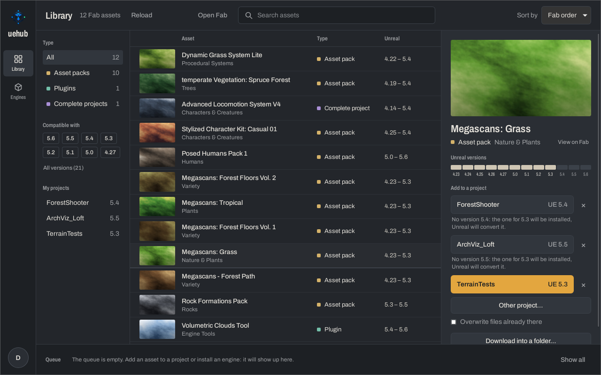
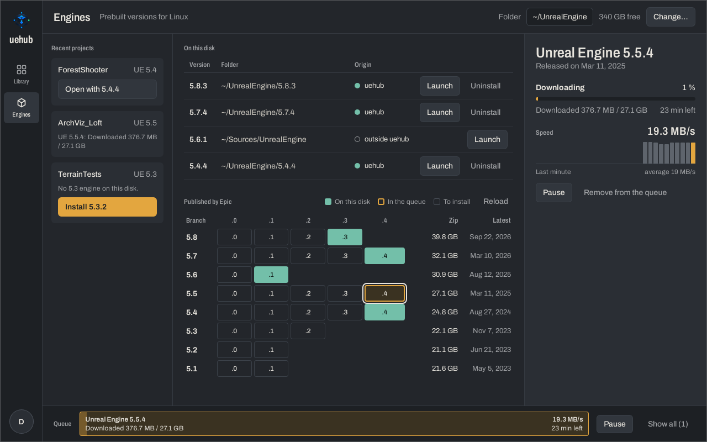
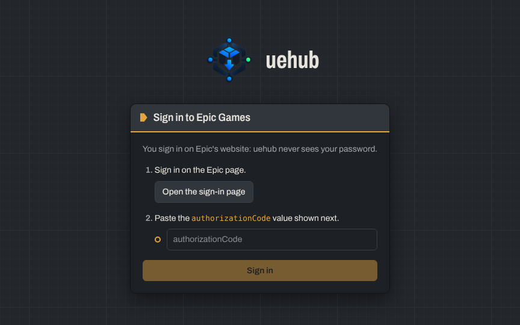

<p align="center">
  
</p>

<h1 align="center">uehub</h1>

<p align="center">
  <strong>Your Fab library and Unreal Engine, on Linux.</strong><br>
  The parts of the Epic Games Launcher that Unreal developers need, without Wine.
</p>

<p align="center">
  English · <a href="README.fr.md">Français</a>
</p>

<p align="center">
  
</p>

## What it does

- **Your Fab library, searchable.** Every asset you own on Fab, with its type, the
  Unreal versions it supports, and filters by engine version or by project.
- **Straight into your projects.** Pick a project and uehub downloads the version that
  matches its engine, puts plugins in `Plugins/`, and refuses to overwrite your files
  unless you ask. A complete project downloads into a folder of its own.
- **A queue that holds on.** Downloads run one at a time, survive pauses, lost
  connections and restarts, and keep what they've already fetched.
- **Updates for what you've added.** uehub remembers each asset it put in a project and
  tells you when the seller publishes a new build, or a version closer to your engine.
  Removing an asset deletes the files it added, and only those.
- **Unreal Engine, installed for you.** The prebuilt Linux releases Epic publishes: pick
  one, check the disk space it needs, and uehub downloads, extracts and registers it so
  your projects open with it. It tells you when a newer patch of your branch is out.
- **Made for a desktop that stays open.** A notification when a download ends while
  you're elsewhere, a check for uehub updates every few hours, and a log that's safe
  to attach to a bug report.
- **English and French**, following your system's language, and a command-line tool for
  scripts and terminals.

<table>
  <tr>
    <td width="50%"></td>
    <td width="50%"></td>
  </tr>
  <tr>
    <td align="center">Installing Unreal Engine 5.5.4</td>
    <td align="center">Signing in, on Epic's own website</td>
  </tr>
</table>

## Install

uehub runs on 64-bit Linux (x86_64). Pick the package for your distribution from the
[latest release](https://github.com/AlexandreSama/uehub/releases/latest):

| Distribution | Package | Updates |
|---|---|---|
| Arch Linux, Manjaro, EndeavourOS | [`uehub` on the AUR](https://aur.archlinux.org/packages/uehub): `yay -S uehub` | your AUR helper |
| Debian, Ubuntu, Linux Mint, Pop!_OS | `uehub_<version>_amd64.deb` | uehub itself |
| Fedora, openSUSE | `uehub-<version>-1.x86_64.rpm` | uehub itself |
| Any other distribution | `uehub_<version>_amd64.AppImage` | uehub itself |

The `.deb`, `.rpm` and AppImage update themselves: uehub checks for a new release, shows
what changed, and installs it once you agree. Every update is signed, and uehub refuses
one whose signature doesn't match.

**What uehub needs**

- WebKitGTK 4.1, which most distributions released since 2022 provide (the packages
  pull it in).
- A keyring that speaks the Secret Service API (GNOME Keyring, KWallet) to keep your
  session. Without one, uehub keeps it in a file only you can read.
- Disk space for engines: Unreal Engine 5.8 takes about 70 GB once extracted, plus its
  40 GB zip while it installs. uehub checks before it starts.

## Getting started

1. **Sign in.** uehub opens Epic's sign-in page in your browser. Once you're signed in,
   Epic shows a short JSON text: copy the value of `authorizationCode` and paste it into
   uehub. You sign in on Epic's website, so uehub never sees your password. Your session
   then stays in your system keyring.
2. **Add an asset to a project.** Pick an asset in the library. Your recent projects
   are listed with what will happen for each: the exact version, or an older one that
   Unreal will convert. Click a project, or choose another `.uproject`.
3. **Install an engine.** Open **Engines**. The first time, Epic asks you to accept the
   Unreal Engine EULA on its website: uehub opens the page for you. Then pick a version
   in the grid and install it. It's registered in `~/.config/Epic/UnrealEngine/Install.ini`,
   like an engine you built yourself, and your projects open with it from uehub.

## Command line

uehub also has a command-line tool, `uehub`, built from `crates/cli`. It shares the
desktop app's session, recent projects and engines. It isn't in the packages yet:
install it with `cargo install` (see [Build from source](#build-from-source)). The
desktop app's own command is `uehub-desktop`, so the two don't clash.

```bash
uehub auth-url                                  # the Epic sign-in address
uehub login <authorizationCode>                 # sign in
uehub library                                   # list your Fab library
uehub add "Megascans: Grass" ~/Projects/Forest/Forest.uproject
uehub download "Rock Formations" --out ~/Assets/Rocks
uehub remove "Megascans: Grass" ~/Projects/Forest/Forest.uproject
uehub engines                                   # installed engines, and Epic's releases
uehub engines install 5.8.3
```

`uehub --help` and `uehub <command> --help` list every option.

## Where uehub keeps its files

| What | Where |
|---|---|
| Your Epic session | your system keyring, or `~/.local/share/uehub/session.json` without one |
| The queue and settings | `~/.local/share/dev.uehub.desktop/` |
| Recent projects | `~/.local/share/uehub/recent_projects.json` |
| Downloads in progress, thumbnails, Epic's engine list | `~/.cache/uehub/` |
| The log | `~/.local/state/uehub/uehub.log` |
| What uehub added to a project | `Saved/uehub/assets.json`, inside the project |
| Engines | `~/UnrealEngine/<version>` by default, registered in `~/.config/Epic/UnrealEngine/Install.ini` |

uehub talks to Epic Games (sign-in, your library, the engine downloads), to Fab's CDN, and
to GitHub to look for its own updates. Nothing else: no analytics, no telemetry.

## Reporting a bug

Open the account menu (your initial, bottom left) and click **Show the log**: it opens the
folder with `uehub.log` selected. Attach that file to a
[new issue](https://github.com/AlexandreSama/uehub/issues/new) with what you did and what you
expected. The log masks tokens, cookies, codes and signed addresses before writing them,
and replaces your home folder with `~`, so it's safe to share.

## Build from source

You'll need [Rust](https://rustup.rs) 1.90 or newer, [Node.js](https://nodejs.org) 22, and
the libraries Tauri builds against:

```bash
# Debian, Ubuntu
sudo apt install libwebkit2gtk-4.1-dev build-essential curl wget file libxdo-dev \
  libssl-dev libayatana-appindicator3-dev librsvg2-dev
# Arch Linux
sudo pacman -S --needed webkit2gtk-4.1 base-devel curl wget file openssl \
  appmenu-gtk-module libappindicator-gtk3 librsvg xdotool
# Fedora
sudo dnf install webkit2gtk4.1-devel openssl-devel curl wget file \
  libappindicator-gtk3-devel librsvg2-devel libxdo-devel
sudo dnf group install "c-development"
```

These are the lists from [Tauri's prerequisites](https://v2.tauri.app/start/prerequisites/).

Then:

```bash
git clone https://github.com/AlexandreSama/uehub.git
cd uehub/desktop
npm ci
npm run tauri dev                      # run the app with live reload
npm run tauri build                    # or build the .deb, .rpm and AppImage
cargo install --path ../crates/cli     # the command-line tool, in ~/.cargo/bin
```

The `.deb`, `.rpm` and AppImage you build update themselves like the released ones.
`npm run tauri dev`, `cargo build` and the AUR package don't: uehub leaves updates to
whatever installed it.

## Contributing

Bug reports, ideas and pull requests are welcome. Before you open a pull request:

```bash
cargo fmt --all --check
cargo clippy --workspace --all-targets -- -D warnings
cargo test --workspace
cd desktop && npx tsc --noEmit && npm test
```

GitHub Actions runs the same checks on every push. By sending a contribution, you agree
to the terms in section 4 of the [license](LICENSE): you keep your copyright, and uehub
may use your work.

**Translations.** Every text lives in `locales/en.json` and `locales/fr.json`, shared by
the app, the interface and the command line. `cargo test` checks that both files have the
same texts with the same variables. To add a language, copy `en.json`, translate it, and
register the language in `crates/core/src/i18n.rs` and `desktop/src/i18n.ts`.

## License

uehub is free, and its source is public so anyone can read it and help improve it. It is
**not open source**: the [uehub License](LICENSE) is its own.

| You may | You may not |
|---|---|
| Use uehub on any number of computers, for anything, including commercial game projects | Redistribute uehub or a changed version: no mirrors, packages or installers of your own |
| Read and study the code | Sell it, charge for it, or put ads in it |
| Fork it on GitHub and change it to send pull requests | Present it or its code as your own, or reuse its name or logo |
|  | Copy its code into another project |

The libraries and the font that uehub includes keep their own licenses, listed in
[THIRD-PARTY-NOTICES.md](THIRD-PARTY-NOTICES.md).

## Not affiliated with Epic Games

uehub is an independent project, not affiliated with, endorsed by or sponsored by Epic
Games. Epic Games, Unreal Engine and Fab are trademarks of Epic Games, Inc. uehub uses the
web services Epic Games provides to its users, with your own account: you remain bound by
their terms, and a change on Epic's side can stop uehub from working until it's updated.

<p align="center">© 2026 DjinnSama</p>
